# UK & Ireland Retail Analytics: Where Should a Homeware Retailer Grow Next?

**An end-to-end sales analysis for a homeware retailer with stores in 12 cities: London, Birmingham, Manchester, Leeds, Glasgow, Liverpool, Sheffield, Bristol, Edinburgh, Cardiff, Belfast and Dublin.** Each city is measured as its city-region (for example, Greater London or the 10 Greater Manchester boroughs), so all 12 are compared on the same kind of area.

The project combines the **latest official statistics** (ONS, CSO, US Census Bureau, Taiwan MOEA) with a simulated customer-level dataset for a fictional retailer, *Hearthline*, calibrated to those statistics. It runs from raw downloads to a SQL Server star schema, Python analysis, an Excel pack for regional managers and a Power BI report.

`SQL Server (T-SQL)` · `Python (pandas, NumPy, matplotlib)` · `Power BI (star schema, DAX, RLS)` · `Excel (SUMIFS, INDEX/MATCH, data validation)`

---

## Key findings

| | |
|---|---|
| **London is under-served** | Greater London holds **42%** of the 12 city-regions' spending power but brings only **21%** of store revenue (market capture index **0.49**). One store cannot serve a market of 9 million people. |
| **Every other store over-performs** | All 11 other stores capture more than their fair share, led by Belfast (**2.31**). The real data shows why: the Belfast region's retail output is **1.7×** what its residents' income alone would predict, the highest of the 12. |
| **A quarter of customers drive most revenue** | RFM "Champions" are **26%** of identified customers and **58%** of revenue. |
| **Half of new customers come back** | On average **52%** of new customers buy again in the next quarter. |
| **Clear bundles** | Gift sets and wrapping kits are bought together **22×** more often than chance; lamps and bulbs **11×**. (The pairs are planted in the simulation, so this tests the method; the ranking depends on random product popularity.) |
| **The UK is the most online market** | **28%** of UK retail sales are online, against **17%** in the US and **14%** in Taiwan. |
| **The US is the largest market** | US retail sales (£5.5tn in 2025) are **11×** the UK's (£483bn) and grew fastest, **5.4%** a year since 2019, against 3.5% in the UK and 3.6% in Taiwan (£118bn). |

### Power BI report

Four pages built on the SQL Server star schema: **Overview** (KPIs, monthly revenue by channel, store league table), **Cities vs market** (market capture index against official spending power), **Customers** (RFM segments, cohort retention, product bundles) and **Markets** (UK, US and Taiwan online share). PDF: [`powerbi/Hearthline_Retail.pdf`](powerbi/Hearthline_Retail.pdf).

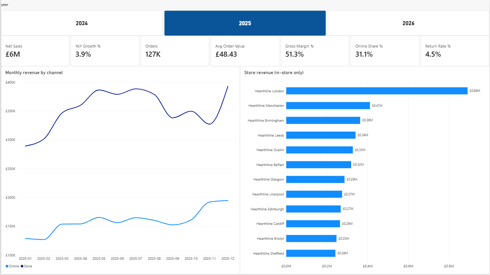

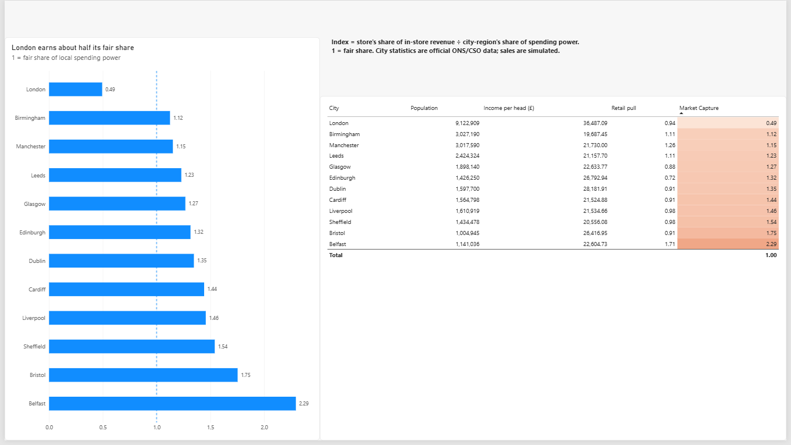

<details>
<summary>More pages: Customers, Markets</summary>

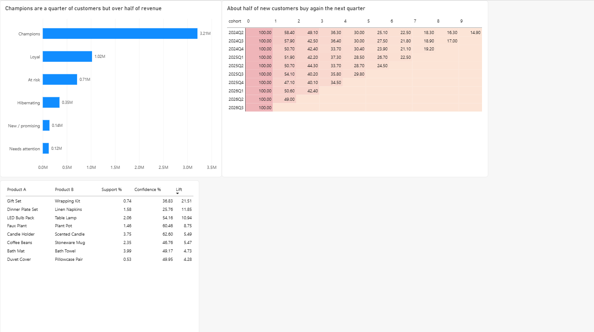
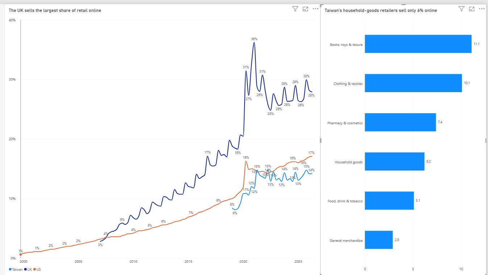

</details>

### Python charts

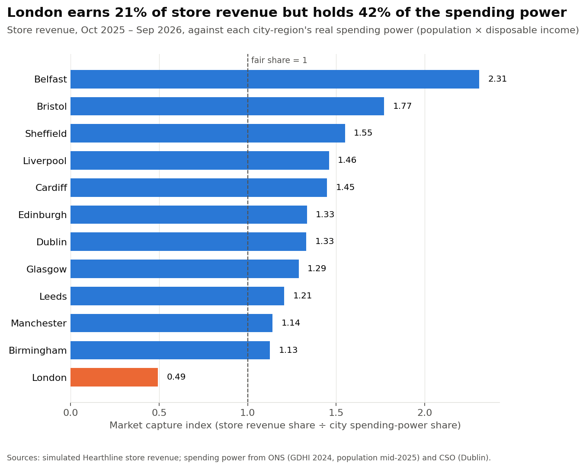

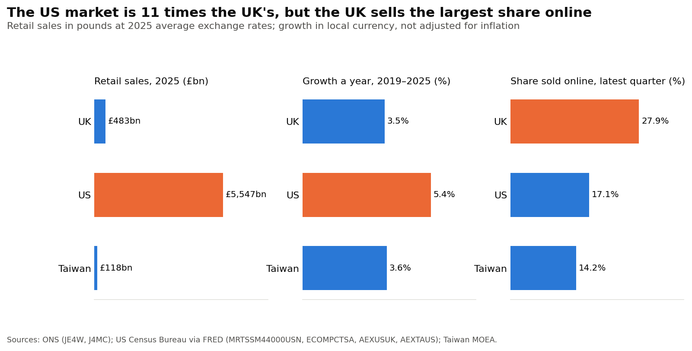

<details>
<summary>More charts: RFM segments, cohort retention, market basket, online share, Taiwan retailers</summary>

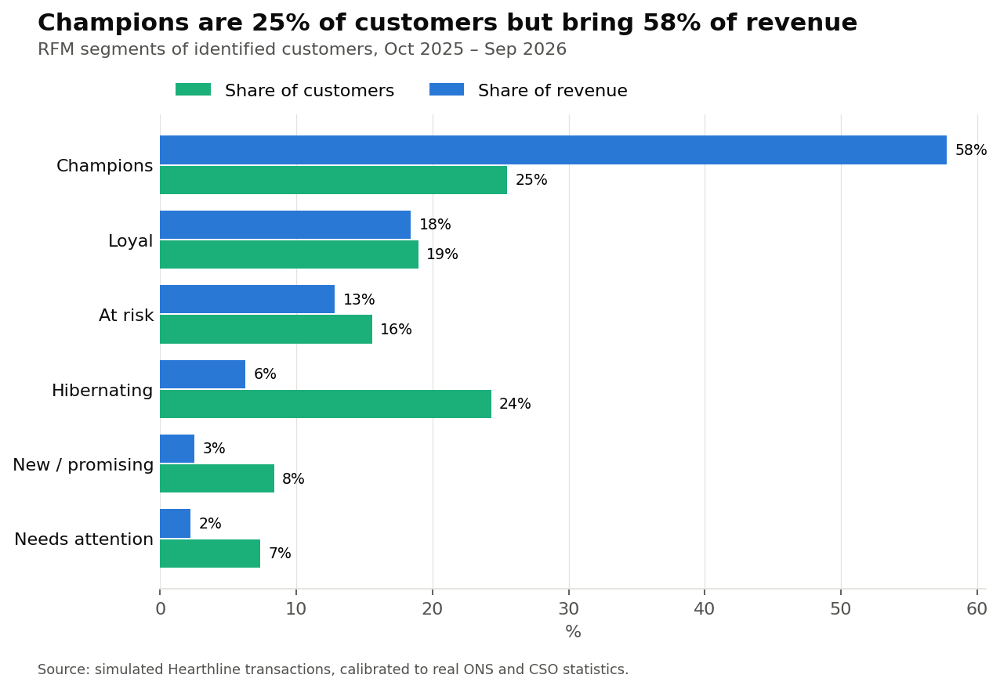
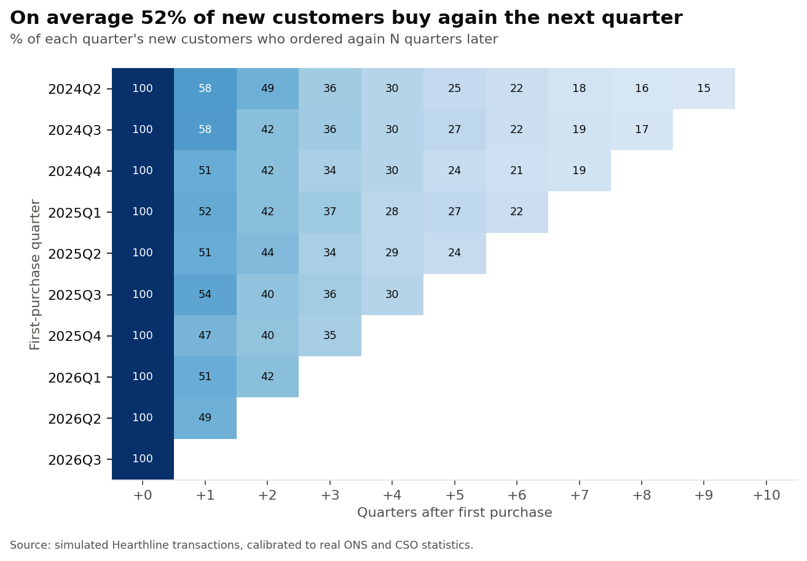
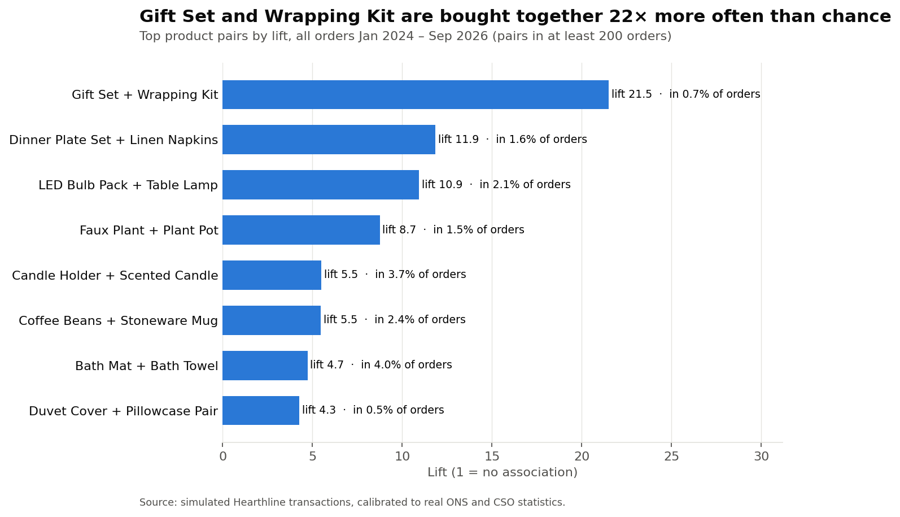
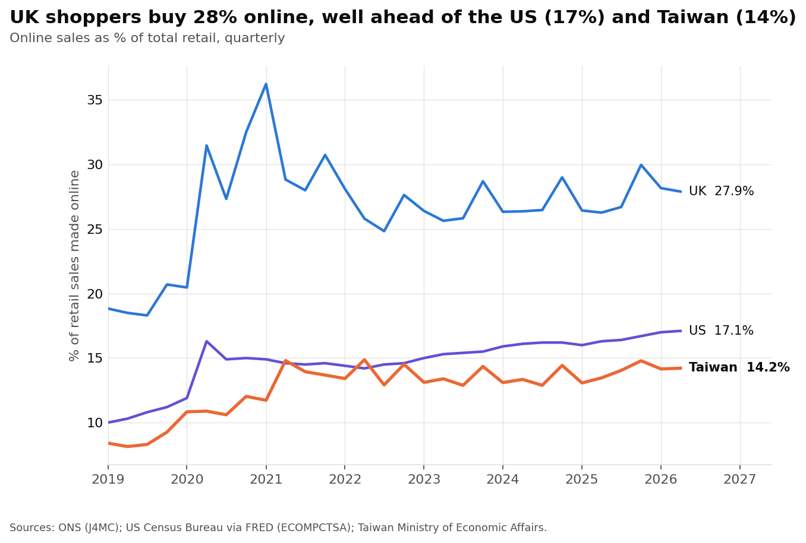
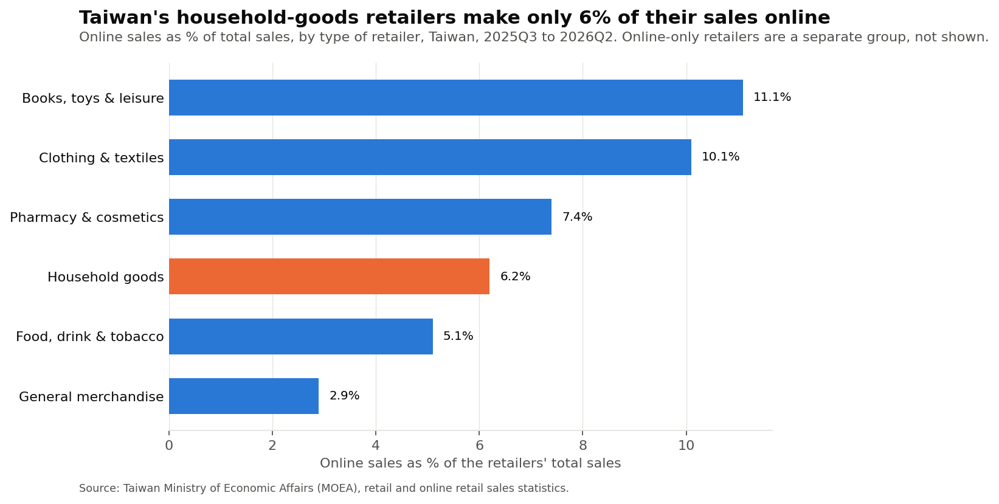

</details>

### Recommendations
1. **Open a second London store before expanding abroad.** London is our largest market and the most under-served one.
2. **Protect the Champions** with early access and member-only offers, and win back the "At risk" group before they lapse.
3. **Act on the first repeat purchase:** a follow-up offer in the quarter after a customer's first order, while half of them are still likely to return.
4. **Sell the strong pairs as bundles**, online and at the till.
5. **Grow at home first.** The UK sells the largest share of retail online, so the home market is not saturated. Any move abroad should start as a small online marketplace pilot.

<!-- MY ANALYSIS (Jane): add 2–3 sentences in your own words here -->

---

## Business questions and where they are answered

| Business question | SQL (`sql/04_business_questions.sql`) | Python (`03_analysis.ipynb`) |
|---|---|---|
| How is the company performing overall? | Q1 monthly revenue and year-on-year growth · Q5 top 3 products per category · Q6 margin and returns by category · Q7 return rate by channel and reason | Headline KPIs |
| 1. Which stores under- or over-perform **relative to the real size of their local market**? | Q2 store league table · Q3 market capture index | Figure 1 |
| 2. Who are our customers, and which groups drive revenue? | Q9 days between purchases | RFM segments, Figure 2 |
| 3. Do new customers come back? | Q8 cohort retention | Figure 3 |
| 4. Which products are bought together? | Q10 market basket (self-join) | Figure 4 |
| 5. How does the UK's retail market potential compare with the US and Taiwan? | Q4 where online customers live | Figures 5, 6 and 7 (official data) |

## Data: what is real and what is simulated

| Real (official, latest available) | Publisher | Used for |
|---|---|---|
| Population estimates, mid-2025 | ONS | market size by city-region |
| Gross disposable household income (GDHI), 2024 | ONS | spending power |
| Annual Survey of Hours and Earnings (ASHE), 2025 provisional | ONS | city profile (median pay) |
| Retail gross value added (SIC 47) by local authority, 2024 | ONS | store sizing, retail pull |
| Internet sales as % of retail sales (J4MC), monthly | ONS | UK online share |
| Average weekly value of all retailing (JE4W), monthly | ONS | UK market size and growth |
| Retail trade sales (MRTSSM44000USN); e-commerce share (ECOMPCTSA) | US Census Bureau via FRED | US market size, growth, online share |
| Retail sales and online retail sales by type of retailer | Taiwan MOEA | Taiwan market size, growth, online share |
| Annual average exchange rates (AEXUSUK, AEXTAUS) | Federal Reserve via FRED | converting to pounds |
| Dublin population and disposable income | CSO Ireland | Dublin profile |

**Simulated:** Hearthline's 341,966 orders, 827,926 order lines, 70,000 customers and 45,902 returns (Jan 2024 – Sep 2026). No real, recent customer-level retail data is public (retailers do not release it and UK GDPR protects it), so I generated it with `src/generate_data.py` (fixed random seed, so it is reproducible). **Every input is an official statistic, a published benchmark, or a stated assumption** (full register in the report, section 3.4):

| Input | Value | Source | Type |
|---|---|---|---|
| Store demand | city-region retail GVA, 2024 | ONS | Official |
| Online share of orders | 26–30% by month | ONS J4MC | Official |
| Seasonality and growth | Nov 1.12×, Dec 1.23× an average month; 3.5% a year | ONS JE4W, 2019–2025 | Official |
| Customer age mix | UK adult population | ONS mid-2025 estimates | Official |
| Product prices | £2.99–£84.99, all colours of an item at the same price | median on Dunelm's category pages, Oct 2026 ([`data/raw/dunelm_prices_2026-10.csv`](data/raw/dunelm_prices_2026-10.csv); 8 types weak evidence, n ≤ 2; 3 types assumed) | Benchmark |
| Product cost | 38–55% of price | gives 51.4% margin vs Dunelm FY25 52.4% | Benchmark |
| Store floor area | 3,300–4,500 sq ft | small-format homeware shops: Oliver Bonas Glasgow Fort 2,800, Dunelm Westfield London 4,500 | Benchmark |
| Return rates | 10% online, 3.6% in store (lines) | IMRG (online 15–17% all categories); Appriss Retail & Deloitte 2024 (online ÷ store = 2.8) | Benchmark |
| Store capacity exponent | 0.45 | no published estimate; tested 0.3–1.0 | Assumption |
| Scale | ~120,000 orders a year, 70,000 customers | small 12-store chain; ~2.8 orders per active customer a year; Fermi check: ~21 in-store sales per store per day | Assumption |
| Existing customers | 30% joined before 2024, earliest 2019 | an established chain already has customers | Assumption |

**Validation against benchmarks that were not used to set it:**

| Check | Simulated | Benchmark |
|---|---|---|
| Store revenue vs real retail output (log) | correlation 0.99 | high by design |
| Monthly online share vs ONS | mean gap 0.4 pp | 0 |
| Gross margin | 51.4% | 52.4% (Dunelm FY25) |
| Top 20% of customers' share of revenue | 58% | 50–73% (Sharp et al. 2019; Kim et al. 2017) |
| Online ÷ in-store return rate | 2.9 | 2.8 (Appriss Retail & Deloitte 2024) |

**The one assumption that drives a headline finding** is that a single store's sales grow less than in proportion to its market (store revenue ∝ retail output^0.45), because one shop can only serve so many people. A sensitivity test on official data alone:

| Exponent | London's expected capture index | Cities below 1 |
|---|---|---|
| 0.3 | 0.34 | London only |
| **0.45 (used)** | **0.43** | London only |
| 0.6 | 0.55 | London only |
| 0.8 | 0.73 | 2 |
| 1.0 | 0.94 | 8 |

London stays the only under-served city up to 0.6; the finding disappears only if one store's sales grow in proportion to its market.

I also added realistic data-quality problems on purpose (messy city names, duplicated lines, zero-price test orders, guest checkouts) so the cleaning step has real work to do.

## Pipeline

```
official statistics ──► 00_download_data ──► 01_city_profile_and_markets ──┐
                                                                            ├──► SQL Server: staging ─► cleaning ─► star schema ─► Power BI report
simulated transactions ◄── 02_generate_simulated_data (calibrated) ─────────┘                                                   └──► Excel manager pack
                                                        03_analysis (Python: market capture, RFM, cohorts, basket, markets)
```

**Star schema (SQL script 03):** `fact_sales` (one row per order line) and `fact_returns`, joined to `dim_date`, `dim_store`, `dim_product` and `dim_customer`. `dim_city` holds the official statistics and links to `dim_store`. That one branch makes the model a small snowflake, which keeps official data separate from company data.

**SQL techniques (script 04):** multi-table joins, CTEs, a recursive CTE (date table), window functions (`LAG` for year-on-year growth and days between orders, `RANK`/`ROW_NUMBER` for league tables and top-N, moving averages), `CASE`, and a self-join for market basket support, confidence and lift.

**Power BI (`powerbi/Hearthline_Retail.pbix`):**
- **Model:** imports the `dw` star schema from SQL Server; 9 single-direction many-to-one relationships; `dim_date` marked as the date table; Auto date/time turned off.
- **Power Query (M):** renamed queries, removed high-cardinality columns (`order_datetime`) to keep the model small, merged RFM segments into `dim_customer` (left outer join) and added a custom column with `Table.AddColumn`.
- **DAX (18 measures, `powerbi/measures.dax`):** `CALCULATE` for channel splits, time intelligence (`SAMEPERIODLASTYEAR`, `TOTALYTD`, `DATESINPERIOD`), `RANKX` for store rank, and a market capture index using `VAR`, `ALL` and `TREATAS`.
- **Row-level security:** a `City Manager` role on `dim_store` (`[manager_email] = USERPRINCIPALNAME()`), tested with *View as*: the Glasgow manager sees only the Glasgow store.

**Excel:** `excel/Regional_Manager_Pack.xlsx`. Pick a city from a drop-down; the KPIs, category table and city facts update through `SUMIFS` and `INDEX/MATCH`.

## Methods

| Method | What it measures | Reference |
|---|---|---|
| Market capture index | Store's share of revenue ÷ its city-region's share of spending power (1 = fair share) | Same idea as the Brand Development Index in Farris et al., *Marketing Metrics* |
| RFM segmentation | Recency, frequency and monetary value, scored 1–5 by quintile | Hughes (1994); Fader, Hardie and Lee (2005), *Journal of Marketing Research* |
| Cohort retention | % of each quarter's new customers who buy again N quarters later | Standard customer-base analysis |
| Market basket | Support, confidence and lift of product pairs | Agrawal, Imieliński and Swami (1993); Brin et al. (1997), ACM SIGMOD |
| Market potential | Size, compound annual growth rate (2019–2025, local currency) and online share | Official national statistics |

## How to run
1. `pip install -r requirements.txt`
2. Run notebooks `00` → `03` in order. Notebook 00 downloads the official data; notebook 02 recreates the simulated data with a fixed seed (or unzip `data/simulated_data.zip` into `data/simulated/`).
3. In SQL Server run `sql/01` → `04`. In `02_load_csv.sql`, set `@folder` to your project's `data\` folder.
4. Open `powerbi/Hearthline_Retail.pbix` in Power BI Desktop (free); the data is embedded, and Refresh works once the database from step 3 exists. Or rebuild it following `powerbi/POWER_BI_GUIDE.md`.

## Limitations
- **The transactions are simulated.** Findings about Hearthline show the method, not real results. The London finding depends on the store-capacity assumption (see the sensitivity table above); it should be re-estimated from real store and catchment data before any investment. The official-data findings (city statistics, market size, growth and online share) stand on their own.
- **Cities are city-regions.** London = Greater London (33 boroughs); English cities = their combined authority; Glasgow, Edinburgh, Cardiff and Belfast = their city-region deal areas; Dublin = the Dublin region (4 councils). Council lists are in `data/clean/city_region_councils.csv`. Median pay is for the core city only, because medians cannot be added up.
- **Some retail output figures are estimated.** ONS suppressed 2024 retail output for every council in the Bristol and Cardiff city-regions and 7 of 8 in Glasgow's, and does not cover Dublin. These are estimated from spending power and flagged in `data/clean/city_region_definitions.csv`.
- **Dublin is not fully comparable.** Its income figure is for 2023, in euro converted at £0.87.
- **Market definitions differ.** The US retail total includes motor vehicle dealers and petrol stations; the UK total includes fuel but not vehicles. Growth rates are nominal (not adjusted for inflation). Only the US online series is seasonally adjusted.

## Repository
```
├── 00_download_data.ipynb               official data downloads (with rate-limit retries)
├── 01_city_profile_and_markets.ipynb    official data → city-region profile, online share, market size
├── 02_generate_simulated_data.ipynb     simulate + check calibration
├── 03_analysis.ipynb                    KPIs, market capture, RFM, cohorts, basket, markets
├── src/                                 generate_data.py, build_excel_pack.py
├── sql/                                 01 staging · 02 load · 03 clean + star schema · 04 business questions
├── powerbi/                             Hearthline_Retail.pbix / .pdf, measures.dax, POWER_BI_GUIDE.md
├── excel/                               Regional_Manager_Pack.xlsx
├── data/raw · data/clean · data/simulated_data.zip
└── images/                              charts used above
```

---
**Pin-Hsuan (Jane) Lee**, University of Warwick
